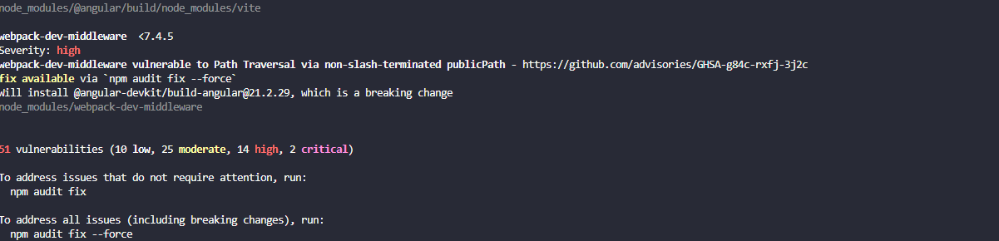
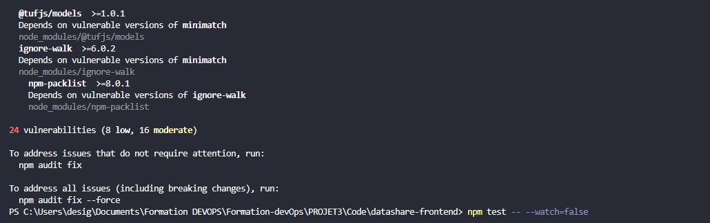

# SECURITY.md — Rapport d'audit de sécurité

**Projet :** DataShare  
**Technologies :** Angular 21, Spring Boot 4.1.1, PostgreSQL, AWS S3  
**Outils :** npm audit, OWASP Dependency-Check, CycloneDX, Trivy  
**Date :** 15 novembre 2026

---

## 1. Objectif de l'audit

L'objectif est d'identifier et de corriger les vulnérabilités connues dans les dépendances frontend et backend de DataShare.

La démarche repose sur un audit initial, l'application des correctifs et un nouveau scan pour vérifier leur efficacité.


## 2. Outils et méthodologie

| Outil | Partie | Objectif |
|---|---|---|
| npm audit | Angular | Analyser les dépendances npm |
| npm audit --omit=dev | Angular | Analyser les dépendances de production |
| OWASP Dependency-Check | Spring Boot | Tentative initiale d'audit Maven |
| CycloneDX | Spring Boot | Générer l'inventaire SBOM |
| Trivy | Spring Boot | Détecter les vulnérabilités et les secrets |

Les vulnérabilités sont classées selon quatre niveaux de gravité :

- **Faible (Low) :** vulnérabilité présentant généralement un impact limité.
- **Modérée (Moderate) :** vulnérabilité nécessitant une analyse selon le contexte.
- **Élevée (High) :** vulnérabilité importante devant être traitée en priorité.
- **Critique (Critical) :** vulnérabilité présentant un risque potentiellement majeur.

Une vulnérabilité détectée dans une dépendance ne signifie pas nécessairement qu'elle est exploitable dans l'application. Son impact dépend notamment des fonctionnalités utilisées et de l'exposition de la dépendance.

## 3. Audit de sécurité du frontend

### 3.1. Audit initial sous Angular 19

Le premier audit des dépendances frontend a été réalisé avec la commande suivante :

```powershell
npm audit
```

Les résultats obtenus étaient les suivants :

| Gravité | Nombre de vulnérabilités |
|---|---:|
| Critique | 2 |
| Élevée | 17 |
| Modérée | 28 |
| Faible | 10 |
| **Total** | **57** |

L'audit initial a donc révélé 57 vulnérabilités, dont 19 de gravité élevée ou critique.

Un audit limité aux dépendances de production avait également signalé sept vulnérabilités, dont quatre élevées et trois modérées.

Ces résultats ont motivé la mise à jour des dépendances du frontend.

### 3.2. Première correction avec npm audit fix

Une première correction a été effectuée avec la commande :

```powershell
npm audit fix
```

Cette opération permet de mettre à jour certaines dépendances dans le respect des contraintes de versions existantes.

Les résultats après correction étaient les suivants :


| Gravité | Avant correction | Après correction |
|---|---:|---:|
| Critique | 2 | 2 |
| Élevée | 17 | 14 |
| Modérée | 28 | 25 |
| Faible | 10 | 10 |
| **Total** | **57** | **51** |

Cette étape a permis de supprimer six alertes.

Cependant, plusieurs vulnérabilités importantes subsistaient. Une migration du framework Angular a donc été entreprise.

### 3.3. Migration d'Angular 19 vers Angular 21

Afin de bénéficier de versions plus récentes du framework et de ses dépendances, une migration progressive a été réalisée :

1. Migration d'Angular 19 vers Angular 20.
2. Vérification de la compilation et des tests automatisés.
3. Migration d'Angular 20 vers Angular 21.
4. Nouvelle analyse des dépendances.

Les commandes de migration utilisées sont :

```powershell
npx ng update @angular/core@20 @angular/cli@20
npx ng update @angular/core@21 @angular/cli@21
```

La commande `ng version` a confirmé les versions suivantes :

| Composant | Version installée |
|---|---|
| Angular | 21.2.26 |
| Angular CLI | 21.2.29 |
| Angular Build | 21.2.29 |
| TypeScript | 5.9.3 |
| Node.js | 24.9.0 |
| npm | 11.6.0 |

La migration a permis de maintenir le frontend sur une version plus récente du framework tout en conservant les fonctionnalités de l'application.

### 3.4. Résultats comparatifs des audits


Les résultats obtenus aux différentes étapes sont présentés ci-dessous.

| Étape | Faibles | Modérées | Élevées | Critiques | Total |
|---|---:|---:|---:|---:|---:|
| Angular 19 — Audit initial | 10 | 28 | 17 | 2 | 57 |
| Après `npm audit fix` | 10 | 25 | 14 | 2 | 51 |
| Après migration Angular 20 | 8 | 16 | 0 | 0 | 24 |
| **Après migration Angular 21** | **8** | **16** | **0** | **0** | **24** |

Le nombre total d'alertes est passé de 57 à 24, soit une réduction d'environ **58 %**.

Les 19 alertes initialement classées comme élevées ou critiques ne sont plus signalées dans le dernier audit.

En revanche, 24 vulnérabilités faibles ou modérées restent présentes dans l'analyse complète des dépendances.

### 3.5. Audit des dépendances de production

Afin de distinguer les vulnérabilités des dépendances de développement de celles des dépendances utilisées en production, un audit complémentaire a été effectué.

**Commande :**

```powershell
npm audit --omit=dev
```

**Résultat :**

```text
found 0 vulnerabilities
```

Le bilan est le suivant :

| Périmètre analysé | Vulnérabilités détectées |
|---|---:|
| Ensemble des dépendances npm | 24 |
| Dépendances hors développement | 0 |

Ce résultat indique qu'aucune vulnérabilité connue n'a été détectée par npm audit parmi les dépendances de production examinées.

Les 24 alertes restantes concernent donc des dépendances exclues par l'option `--omit=dev`.

Ce résultat est encourageant, mais ne signifie pas que le frontend est totalement exempt de risques. Certaines dépendances de développement interviennent notamment dans la compilation et la génération de l'application.

### 3.6. Analyse des vulnérabilités restantes

Les alertes résiduelles concernent notamment des dépendances transitives utilisées par les outils de développement.

Parmi les bibliothèques signalées figurent :

| Dépendance | Observation |
|---|---|
| `deepmerge` | Alerte liée à un risque de prototype pollution |
| `glob` | Alerte concernant certaines opérations de manipulation de chemins |
| `minimatch` | Alerte liée à certains traitements de motifs pouvant entraîner une consommation excessive de ressources |

Ces bibliothèques peuvent être installées indirectement par d'autres dépendances du projet.

La commande suivante permet de consulter les détails :

```powershell
npm audit
```

Les mises à jour devront être réalisées progressivement et suivies d'une nouvelle exécution des tests.

L'utilisation systématique de `npm audit fix --force` a été évitée afin de ne pas introduire de changements majeurs incompatibles avec le projet.

### 3.7. Vérification du fonctionnement après migration

Après la migration, les tests automatisés du frontend ont été utilisés pour vérifier le fonctionnement de l'application.

Les résultats rapportés sont les suivants :

| Vérification | Résultat |
|---|---|
| Suites Jest | 18/18 réussies |
| Tests Jest | 90/90 réussis |
| Couverture des instructions | 90,64 % |
| Couverture des branches | 76,36 % |
| Couverture des fonctions | 92,20 % |
| Couverture des lignes | 90,18 % |
| Tests Cypress — dernière campagne complète | 23/23 réussis |


Ces tests ne remplacent pas non plus un audit de sécurité : ils permettent principalement de vérifier l'absence de régression fonctionnelle après les modifications.

## 4. Audit de sécurité du backend

### 4.1. Méthodologie

Une première analyse avec OWASP Dependency-Check a été interrompue par un problème d'accès aux données NVD.

L'audit a ensuite été réalisé avec CycloneDX et Trivy.

**Génération du SBOM :**

```powershell
.\mvnw.cmd org.cyclonedx:cyclonedx-maven-plugin:2.9.1:makeAggregateBom "-DoutputFormat=json"
```

**Résultat :** 154 composants Maven identifiés.

**Analyse des vulnérabilités :**

```powershell
docker run --rm `
  -v "${PWD}:/src" `
  aquasec/trivy:latest sbom `
  --scanners vuln `
  --format table `
  --output /src/security/trivy-backend.txt `
  /src/security/backend-sbom.json
```

### 4.2. Résultats et corrections

Le premier scan Trivy a identifié **18 vulnérabilités** : 4 critiques, 10 élevées et 4 modérées.

| Dépendance | Version initiale | Version corrigée |
|---|---|---|
| Apache Tomcat | 11.0.24 | 11.0.25 |
| Jackson 2 | 2.21.5 | 2.21.7 |
| Jackson 3 | 3.1.5 | 3.1.7 |

Les versions ont été mises à jour dans le `pom.xml` et confirmées avec `mvn dependency:tree`.

Un nouveau SBOM a été généré, puis analysé avec Trivy.

**Résultat final : 0 vulnérabilité détectée dans les dépendances Java analysées.**

### 4.3. Analyse des secrets

Le scan Trivy a également identifié deux secrets AWS dans le fichier local `.env` :

- AWS Access Key ID
- AWS Secret Access Key

Le fichier `.env` n'est pas suivi par Git, comme confirmé par `git ls-files -- .env`. Les identifiants sont conservés hors du dépôt.

---

## 5. Bilan général

| Vérification | Résultat |
|---|---|
| Audit initial Angular 19 | 57 vulnérabilités |
| Après npm audit fix | 51 vulnérabilités |
| Après migration Angular 20 | 24 vulnérabilités |
| Après migration Angular 21 | 24 vulnérabilités |
| Vulnérabilités critiques Angular 21 | 0 |
| Vulnérabilités élevées Angular 21 | 0 |
| Vulnérabilités modérées Angular 21 | 16 |
| Vulnérabilités faibles Angular 21 | 8 |
| **Audit npm production** | **0 vulnérabilité** |
| Composants Maven inventoriés | 154 |
| Audit backend initial Trivy | 18 vulnérabilités |
| **Audit backend après correction** | **0 vulnérabilité** |
| Analyse des secrets AWS | 2 secrets détectés dans `.env` non versionné |
| Tests backend | 69/70 réussis lors de la dernière exécution communiquée |
| Tests frontend Jest | 90/90 réussis |
| Tests frontend Cypress | 23/23 réussis |

---

## 8. Conclusion

L'audit de sécurité de DataShare a permis de réduire les vulnérabilités connues du frontend de **57 à 24**, soit une diminution d'environ 58 %.

Pour le backend, l'analyse de 154 composants Maven avec CycloneDX et Trivy a permis d'identifier puis de corriger **18 vulnérabilités**, dont 4 critiques.

Le scan final confirme **0 vulnérabilité détectée dans les dépendances backend analysées**.

Les vérifications des secrets AWS ont également permis de confirmer que le fichier local `.env` n'est pas suivi par Git.

Ces actions renforcent la sécurité des dépendances du projet et apportent des résultats mesurables à l'audit.