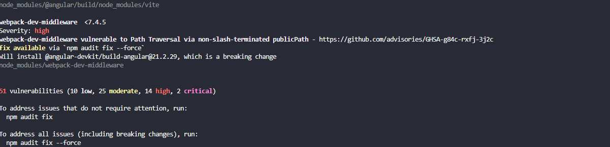
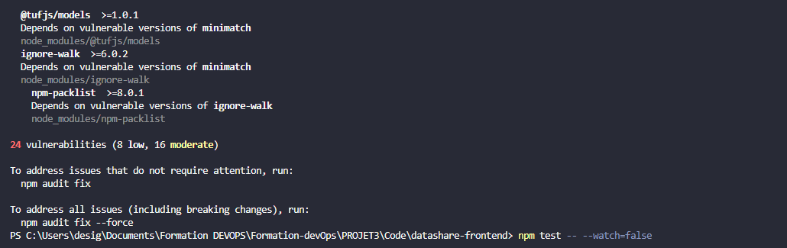

# SECURITY.md — Rapport d'audit de sécurité

**Projet :** DataShare  
**Technologies :** Angular 21, Spring Boot 4.1.1, PostgreSQL, AWS S3  
**Outils d'analyse :** npm audit, OWASP Dependency-Check  
**Date :** 6 novembre 2026

---

## 1. Objectif de l'audit

L'objectif de cet audit est d'évaluer la sécurité des dépendances utilisées dans DataShare, d'identifier les vulnérabilités connues et de mettre en œuvre des mesures correctives lorsque cela est possible.

L'analyse porte principalement sur les dépendances du frontend Angular et du backend Spring Boot.

La démarche consiste à effectuer un premier audit, analyser les résultats, appliquer les corrections nécessaires, puis vérifier que l'application fonctionne toujours correctement.

## 2. Outils et méthodologie

Deux outils ont été retenus pour analyser les dépendances.

| Outil | Partie concernée | Objectif |
|---|---|---|
| `npm audit` | Frontend Angular | Identifier les vulnérabilités connues dans l'ensemble des dépendances npm |
| `npm audit --omit=dev` | Frontend Angular | Vérifier les dépendances npm hors dépendances de développement |
| OWASP Dependency-Check | Backend Spring Boot | Identifier les vulnérabilités connues dans les dépendances Maven |

Les vulnérabilités sont classées selon quatre niveaux de gravité :

- **Faible (Low) :** vulnérabilité présentant généralement un impact limité.
- **Modérée (Moderate) :** vulnérabilité nécessitant une analyse selon le contexte.
- **Élevée (High) :** vulnérabilité importante devant être traitée en priorité.
- **Critique (Critical) :** vulnérabilité présentant un risque potentiellement majeur.

Une vulnérabilité détectée dans une dépendance ne signifie pas nécessairement qu'elle est exploitable dans l'application. Son impact dépend notamment des fonctionnalités utilisées et de l'exposition de la dépendance.

## 3. Audit de sécurité du frontend

### 3.1. Audit initial sous Angular 19

Le premier audit des dépendances frontend a été réalisé avec la commande suivante :

```powershell
npm audit
```

Les résultats obtenus étaient les suivants :

| Gravité | Nombre de vulnérabilités |
|---|---:|
| Critique | 2 |
| Élevée | 17 |
| Modérée | 28 |
| Faible | 10 |
| **Total** | **57** |

L'audit initial a donc révélé 57 vulnérabilités, dont 19 de gravité élevée ou critique.

Un audit limité aux dépendances de production avait également signalé sept vulnérabilités, dont quatre élevées et trois modérées.

Ces résultats ont motivé la mise à jour des dépendances du frontend.

### 3.2. Première correction avec npm audit fix

Une première correction a été effectuée avec la commande :

```powershell
npm audit fix
```

Cette opération permet de mettre à jour certaines dépendances dans le respect des contraintes de versions existantes.

Les résultats après correction étaient les suivants :


| Gravité | Avant correction | Après correction |
|---|---:|---:|
| Critique | 2 | 2 |
| Élevée | 17 | 14 |
| Modérée | 28 | 25 |
| Faible | 10 | 10 |
| **Total** | **57** | **51** |

Cette étape a permis de supprimer six alertes.

Cependant, plusieurs vulnérabilités importantes subsistaient. Une migration du framework Angular a donc été entreprise.

### 3.3. Migration d'Angular 19 vers Angular 21

Afin de bénéficier de versions plus récentes du framework et de ses dépendances, une migration progressive a été réalisée :

1. Migration d'Angular 19 vers Angular 20.
2. Vérification de la compilation et des tests automatisés.
3. Migration d'Angular 20 vers Angular 21.
4. Nouvelle analyse des dépendances.

Les commandes de migration utilisées sont :

```powershell
npx ng update @angular/core@20 @angular/cli@20
npx ng update @angular/core@21 @angular/cli@21
```

La commande `ng version` a confirmé les versions suivantes :

| Composant | Version installée |
|---|---|
| Angular | 21.2.26 |
| Angular CLI | 21.2.29 |
| Angular Build | 21.2.29 |
| TypeScript | 5.9.3 |
| Node.js | 24.9.0 |
| npm | 11.6.0 |

La migration a permis de maintenir le frontend sur une version plus récente du framework tout en conservant les fonctionnalités de l'application.

### 3.4. Résultats comparatifs des audits


Les résultats obtenus aux différentes étapes sont présentés ci-dessous.

| Étape | Faibles | Modérées | Élevées | Critiques | Total |
|---|---:|---:|---:|---:|---:|
| Angular 19 — Audit initial | 10 | 28 | 17 | 2 | 57 |
| Après `npm audit fix` | 10 | 25 | 14 | 2 | 51 |
| Après migration Angular 20 | 8 | 16 | 0 | 0 | 24 |
| **Après migration Angular 21** | **8** | **16** | **0** | **0** | **24** |

Le nombre total d'alertes est passé de 57 à 24, soit une réduction d'environ **58 %**.

Les 19 alertes initialement classées comme élevées ou critiques ne sont plus signalées dans le dernier audit.

En revanche, 24 vulnérabilités faibles ou modérées restent présentes dans l'analyse complète des dépendances.

### 3.5. Audit des dépendances de production

Afin de distinguer les vulnérabilités des dépendances de développement de celles des dépendances utilisées en production, un audit complémentaire a été effectué.

**Commande :**

```powershell
npm audit --omit=dev
```

**Résultat :**

```text
found 0 vulnerabilities
```

Le bilan est le suivant :

| Périmètre analysé | Vulnérabilités détectées |
|---|---:|
| Ensemble des dépendances npm | 24 |
| Dépendances hors développement | 0 |

Ce résultat indique qu'aucune vulnérabilité connue n'a été détectée par npm audit parmi les dépendances de production examinées.

Les 24 alertes restantes concernent donc des dépendances exclues par l'option `--omit=dev`.

Ce résultat est encourageant, mais ne signifie pas que le frontend est totalement exempt de risques. Certaines dépendances de développement interviennent notamment dans la compilation et la génération de l'application.

### 3.6. Analyse des vulnérabilités restantes

Les alertes résiduelles concernent notamment des dépendances transitives utilisées par les outils de développement.

Parmi les bibliothèques signalées figurent :

| Dépendance | Observation |
|---|---|
| `deepmerge` | Alerte liée à un risque de prototype pollution |
| `glob` | Alerte concernant certaines opérations de manipulation de chemins |
| `minimatch` | Alerte liée à certains traitements de motifs pouvant entraîner une consommation excessive de ressources |

Ces bibliothèques peuvent être installées indirectement par d'autres dépendances du projet.

La commande suivante permet de consulter les détails :

```powershell
npm audit
```

Les mises à jour devront être réalisées progressivement et suivies d'une nouvelle exécution des tests.

L'utilisation systématique de `npm audit fix --force` a été évitée afin de ne pas introduire de changements majeurs incompatibles avec le projet.

### 3.7. Vérification du fonctionnement après migration

Après la migration, les tests automatisés du frontend ont été utilisés pour vérifier le fonctionnement de l'application.

Les résultats rapportés sont les suivants :

| Vérification | Résultat |
|---|---|
| Suites Jest | 18/18 réussies |
| Tests Jest | 90/90 réussis |
| Couverture des instructions | 90,64 % |
| Couverture des branches | 76,36 % |
| Couverture des fonctions | 92,20 % |
| Couverture des lignes | 90,18 % |
| Tests Cypress — dernière campagne complète | 23/23 réussis |


Ces tests ne remplacent pas non plus un audit de sécurité : ils permettent principalement de vérifier l'absence de régression fonctionnelle après les modifications.

## 4. Audit de sécurité du backend

### 4.1. Outil retenu

Pour analyser les dépendances du backend Spring Boot, l'outil **OWASP Dependency-Check** a été sélectionné.

Cet outil permet de rechercher des vulnérabilités connues dans les bibliothèques Maven à partir de bases de données de sécurité, notamment la National Vulnerability Database (NVD).

La commande suivante a été exécutée depuis le dossier du backend :

```powershell
./mvnw org.owasp:dependency-check-maven:13.0.0:check
```

### 4.2. Difficulté rencontrée

Lors de l'exécution, le plugin a été téléchargé correctement depuis Maven Central.

Cependant, l'outil n'a pas réussi à récupérer les informations nécessaires depuis la base NVD.

Les principales erreurs rencontrées sont :

```text
Error updating the NVD Data

Invalid API Key, length of 0

NoDataException: No documents exist

BUILD FAILURE
```

Le problème était lié à la récupération des données de vulnérabilités et à l'absence d'une clé API NVD utilisable.

Une demande de clé API NVD était nécessaire pour poursuivre l'analyse dans les conditions rencontrées.

Cependant, **je n'ai pas réussi à obtenir cette clé API**, ce qui ne m'a pas permis de terminer le scan.

### 4.4. Vérifications techniques réalisées sur le backend

Bien que l'audit des dépendances n'ait pas abouti, les tests automatisés du backend ont été exécutés avec succès.

Commande :

```powershell
./mvnw clean verify
```

**Résultats obtenus :**

| Vérification | Résultat |
|---|---|
| Compilation Maven | BUILD SUCCESS |
| Tests exécutés | 66 |
| Tests réussis | 66 |
| Échecs | 0 |
| Erreurs | 0 |
| Couverture des instructions JaCoCo | 91 % |
| Couverture des branches JaCoCo | 80 % |

Ces résultats permettent de confirmer le bon déroulement des tests et le respect du seuil de couverture fixé pour le projet.

Ils ne permettent toutefois pas de conclure à l'absence de vulnérabilités de sécurité dans les dépendances du backend.

## 5. Bilan général

| Vérification | Résultat |
|---|---|
| Audit initial Angular 19 | 57 vulnérabilités |
| Après `npm audit fix` | 51 vulnérabilités |
| Après migration Angular 20 | 24 vulnérabilités |
| Après migration Angular 21 | 24 vulnérabilités |
| Vulnérabilités critiques sous Angular 21 | 0 |
| Vulnérabilités élevées sous Angular 21 | 0 |
| Vulnérabilités modérées sous Angular 21 | 16 |
| Vulnérabilités faibles sous Angular 21 | 8 |
| **Audit npm des dépendances de production** | **0 vulnérabilité détectée** |
| Audit OWASP backend | Non réalisé jusqu'au terme : clé API NVD non obtenue |
| Tests backend | 66/66 réussis |
| Tests frontend Jest | 90/90 réussis |
| Tests frontend Cypress | 23/23 réussis lors de la dernière campagne complète |

## 8. Conclusion

L'audit de sécurité réalisé sur DataShare a permis d'identifier puis de réduire significativement les vulnérabilités connues dans les dépendances du frontend.

La migration progressive d'Angular 19 vers Angular 21 a contribué à faire passer le nombre total d'alertes de **57 à 24**, soit une réduction d'environ 58 %.

Concernant le backend, l'outil OWASP Dependency-Check a été installé et lancé, mais le scan n'a pas pu être terminé à cause d'une difficulté d'accès aux données NVD. Malgré la tentative effectuée, je n'ai pas réussi à obtenir la clé API nécessaire pour poursuivre l'analyse.

En parallèle, les tests automatisés ont confirmé le bon fonctionnement des fonctionnalités testées du projet, avec 66 tests backend et 90 tests Jest réussis, ainsi que 23 tests Cypress réussis lors de la dernière campagne complète.

En conclusion, cette démarche a permis d'améliorer de manière mesurable la sécurité des dépendances frontend de DataShare et d'identifier les vérifications restant à effectuer. L'audit backend constitue une limite technique documentée et une piste d'amélioration pour la suite du projet.