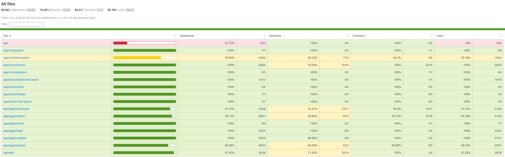

# TESTING.md — Plan de tests et rapport de couverture

**Projet :** DataShare  
**Application :** Partage sécurisé de fichiers  
**Technologies :** Angular, Spring Boot, PostgreSQL, AWS S3  
**Outils de test :** JUnit 5, Mockito, Maven, JaCoCo, Jest, Cypress  
**Date du rapport :** 14 novembre 2026 (mise à jour du backend)

---

## 1. Objectif des tests

L'objectif de cette campagne est de vérifier le bon fonctionnement de DataShare, de prévenir les régressions et de garantir un niveau satisfaisant de qualité logicielle.

Les tests portent sur les fonctionnalités critiques :

- Inscription et connexion des utilisateurs.
- Authentification et validation des tokens JWT.
- Téléversement des fichiers.
- Génération et utilisation des liens de partage.
- Téléchargement avec ou sans mot de passe.
- Gestion de l'expiration des fichiers.
- Consultation de l'historique.
- Suppression des fichiers.
- Contrôle d'accès aux fonctionnalités protégées.

Les critères de validation retenus sont :

1. Réussite de la compilation frontend et backend.
2. Exécution des tests automatisés sans échec.
3. Couverture du code d'au moins 70 %.
4. Vérification des fonctionnalités critiques.
5. Documentation des anomalies et des limites des tests.

## 2. Environnement de test

### 2.1 Backend

| Élément | Technologie |
|---|---|
| Langage | Java 21.0.7 LTS |
| Framework | Spring Boot 4.1.1 |
| Gestion des dépendances | Maven Wrapper 3.9.16 |
| Base de données | PostgreSQL |
| Stockage des fichiers | AWS S3 |
| Tests Java | JUnit 5 et Mockito |
| Mesure de couverture | JaCoCo 0.8.14 |
| Tests d'intégration | Spring Boot Test / infrastructure de test selon les classes concernées |

### 2.2 Frontend

| Élément | Technologie |
|---|---|
| Framework | Angular 21.2.26 |
| Langage | TypeScript 5.9.3 |
| Environnement Node.js | 24.9.0 |
| Tests unitaires et composants | Jest |
| Tests end-to-end | Cypress 16.2.1 |
| Navigateur de validation | Chrome |

La migration du frontend a été réalisée progressivement d'Angular 19 vers Angular 20, puis Angular 21.

Les résultats de tests chiffrés présentés ci-dessous ont été obtenus pendant la validation d'Angular 20. Les mêmes contrôles doivent être confirmés sur l'état final d'Angular 21.

## 3. Stratégie de tests

Trois niveaux de tests sont utilisés.

### 3.1 Tests unitaires

Les tests unitaires vérifient des unités de code isolées, telles que les services, validateurs, fonctions utilitaires et contrôles d'accès.

Ils permettent notamment de vérifier les règles métier et le comportement des composants face à des réponses simulées.

### 3.2 Tests d'intégration

Les tests d'intégration vérifient le fonctionnement de plusieurs composants logiciels ensemble.

Pour le backend, les contrôles à privilégier concernent :

- La réception des requêtes HTTP.
- L'application des règles Spring Security.
- La validation des données.
- Les opérations de persistance.
- Le comportement des endpoints en cas d'erreur.

Les tests utilisant `MockMvc`, `@SpringBootTest`.

### 3.3 Tests end-to-end

Les tests Cypress vérifient les parcours utilisateurs dans un navigateur.

Ils couvrent notamment les interactions avec les formulaires, les redirections, les validations et les réponses affichées à l'utilisateur.

Certains scénarios utilisent `cy.intercept()` pour simuler les réponses HTTP.
## 4. Plan de tests fonctionnels


| ID | Fonctionnalité | Scénario | Résultat attendu |
|---|---|---|---|
| T01 | Inscription | Créer un compte avec des informations valides | Envoi d'une requête POST `/api/register` avec l'email et le mot de passe, puis redirection vers `/login` après une réponse HTTP 201 simulée |
| T02 | Inscription | Utiliser une adresse email déjà enregistrée | Affichage du message « Cet email est déjà utilisé. » après une réponse HTTP 409 simulée et maintien sur `/register` |
| T03 | Inscription | Saisir deux mots de passe différents | Affichage du message « Les mots de passe ne correspondent pas. » sans appel à l'API |
| T04 | Connexion | Se connecter avec des identifiants valides | Envoi des identifiants à `/api/login`, stockage du JWT dans le `localStorage`, redirection vers `/upload` et affichage du lien « Mon espace » |
| T05 | Connexion | Saisir des identifiants incorrects | Affichage du message « Email ou mot de passe incorrect. » après une réponse HTTP 401 simulée et maintien sur `/login` |
| T06 | Connexion | Soumettre un formulaire invalide | Affichage des erreurs de validation de l'email et du mot de passe, sans appel à l'API |
| T07 | Authentification | Accéder à `/history` sans être connecté | Redirection automatique vers `/login` |
| T08 | Upload | Sélectionner un fichier | Affichage des informations du fichier sélectionné |
| T09 | Upload | Téléverser un fichier avec mot de passe et expiration | Affichage du lien de partage après une réponse API simulée |
| T10 | Upload | Saisir un mot de passe trop court | Rejet de la saisie selon les règles de validation de l'interface |
| T11 | Upload | Simuler un refus du backend lors du téléversement | Affichage du message d'erreur correspondant |
| T12 | Téléchargement | Utiliser un lien sans mot de passe et sans être connecté | Affichage des métadonnées, absence du champ mot de passe, envoi de `{ password: null }` et navigation vers l'URL de téléchargement simulée |
| T13 | Téléchargement | Saisir un mauvais mot de passe | Bouton initialement désactivé, activation après saisie, envoi du mot de passe et affichage du message « Mot de passe incorrect. » après un HTTP 403 simulé |
| T14 | Téléchargement | Utiliser un lien expiré | Affichage du message d'expiration après un HTTP 410 simulé et absence du bouton de téléchargement |
| T15 | Téléchargement | Utiliser un lien invalide | Affichage du message « Ce lien de partage est invalide. » après un HTTP 404 simulé |
| T16 | Historique | Consulter la liste des fichiers | Affichage des deux fichiers simulés, de leur état d'expiration et absence de boutons d'action sur le fichier expiré |
| T17 | Historique | Filtrer les fichiers actifs et expirés | Affichage uniquement du fichier correspondant au filtre sélectionné |
| T18 | Historique | Accéder à un fichier depuis la liste | Redirection vers `/download/token-actif` |
| T19 | Suppression | Confirmer la suppression d'un fichier | Envoi d'une requête DELETE, réception d'un HTTP 204 simulé et disparition du fichier de la liste affichée |
| T20 | Suppression | Annuler la suppression d'un fichier | Aucune requête DELETE envoyée et conservation des deux fichiers dans la liste |
| T21 | Session | Se déconnecter | Redirection vers `/`, suppression du JWT dans le `localStorage` et affichage du lien « Se connecter » |
| T22 | Responsive | Accéder à un fichier sur mobile | Bouton classique masqué, ouverture du menu `⋮` et navigation vers `/download/token-actif` |
| T23 | Responsive | Ouvrir le menu latéral sur mobile | Menu latéral initialement masqué, puis affiché après clic sur le bouton burger |

## 5. Tests backend — JUnit et Mockito

### 5.1 Commande d'exécution

Depuis le dossier `datashare-backend` :

```powershell
.\mvnw.cmd "-Dtest=ExpiredFileCleanupServiceTest" test
```

Pour relancer l'ensemble des tests et générer le rapport JaCoCo :

```powershell
.\mvnw.cmd clean verify
```

La commande `clean verify` a été exécutée le **14 novembre 2026** après les modifications : **70 tests réussis, aucun échec, BUILD SUCCESS**. Le rapport JaCoCo a été régénéré.

### 5.2. Campagne initiale — 6 novembre 2026

| Indicateur | Résultat vérifié |
|---|---:|
| Tests backend exécutés | 66 |
| Tests réussis | 66 |
| Échecs / erreurs / ignorés | 0 / 0 / 0 |
| Compilation Maven | BUILD SUCCESS |

Répartition historique de la campagne initiale :

| Classe de test | Nombre de tests |
|---|---:|
| `DatashareBackendApplicationTests` | 1 |
| `FileServiceTest` | 35 |
| `JwtServiceTest` | 4 |
| `S3StorageServiceTest` | 4 |
| `UserServiceTest` | 8 |
| `UserControllerTest` | 4 |
| `FileControllerTest` | 10 |
| **Total (6 novembre)** | **66** |

Cette répartition ne constitue pas un inventaire actualisé des tests après ajout des nouveaux composants.

### 5.3. Nouveaux tests — nettoyage des fichiers expirés (14 novembre 2026)

La fonctionnalité de nettoyage planifié vise à retirer les fichiers expirés du stockage AWS S3 et leurs métadonnées PostgreSQL. Un nouveau service `ExpiredFileCleanupService` utilise une horloge UTC injectable et délègue la suppression au `FileService` existant.

La classe `ExpiredFileCleanupServiceTest` comporte quatre tests unitaires:

| Test | Comportement vérifié |
|---|---|
| `shouldDeleteExpiredFiles` | Le service demande la suppression des fichiers retournés par le repository |
| `shouldDoNothingWhenNoFileIsExpired` | Aucune suppression si le repository ne trouve aucun fichier expiré |
| `shouldContinueWhenOneDeletionFails` | Une erreur sur un fichier ne bloque pas les autres suppressions |
| `shouldUseUtcTimeFromClock` | La recherche utilise l'heure UTC fournie par l'horloge injectable |

**Résultat d'exécution du 14 novembre 2026 :**

```text
Tests run: 4, Failures: 0, Errors: 0, Skipped: 0
BUILD SUCCESS
```

Ces tests isolent `FileRepository` et `FileService` avec Mockito : ils prouvent le comportement du service de nettoyage, **pas** la suppression physique d'objets dans un bucket AWS S3 réel.

### 5.4. Vérification en exécution — tâche planifiée

Le 14 novembre 2026, le backend démarré a produit les messages suivants :

```text
Expired files cleanup: found=29, deleted=29, failed=0
Expired files deleted: 29
```

Les journaux Hibernate montrent également des instructions `DELETE` dans les tables `file_tags` et `files`. Ces traces confirment le déclenchement de la tâche planifiée et l'exécution de suppressions SQL.

### 5.5. Régression sur la suppression manuelle

L'ancien test `test_delete_expired_file_throws_conflict` attendait une erreur HTTP 409, conformément à l'ancien comportement du backend. La règle a été modifiée pour permettre au propriétaire de supprimer un fichier déjà expiré.

Le test doit maintenant vérifier que l'appel `FileService.deleteFile(id, email)` ne lève pas d'exception liée à l'expiration et qu'il sollicite la suppression de l'objet S3 puis des métadonnées.

### 5.6. Validation de la suite backend complète — 14 novembre 2026

La suite Maven complète a été exécutée après l’ajout du nettoyage automatique et la modification du comportement de suppression des fichiers expirés.

**Commande :**

```powershell
.\mvnw.cmd clean verify
```

| Indicateur | Résultat confirmé |
|---|---:|
| Tests exécutés | **70** |
| Tests réussis | **70** |
| Échecs | **0** |
| Erreurs | **0** |
| Tests ignorés | **0** |
| Compilation et empaquetage | **BUILD SUCCESS** |
| Rapport JaCoCo généré | **Oui** |
| Classes analysées par JaCoCo | **25** |

Cette exécution complète constitue le nouveau résultat de référence du backend et remplace le total historique de 66 tests.

L’ajout de quatre tests portant sur `ExpiredFileCleanupService` permet de vérifier l’utilisation de l’horloge UTC, la sélection des fichiers expirés, l’absence d’action lorsque la liste est vide et la poursuite du nettoyage après un échec individuel.

## 6. Tests frontend — Jest

### 6.1 Commande d'exécution

Depuis le dossier `datashare-frontend` :

```powershell
npx jest --runInBand
```

L'option `--runInBand` exécute les suites séquentiellement, ce qui permet de limiter l'utilisation simultanée des ressources.

### 6.2 Résultats

| Indicateur | Résultat |
|---|---:|
| Suites de tests | 18 |
| Suites réussies | 18 |
| Tests exécutés | 90 |
| Tests réussis | 90 |
| Échecs | 0 |

Le périmètre des tests comprend notamment :

- Services d'authentification et de fichiers.
- Intercepteur d'authentification.
- Guard de navigation.
- Validateur de confirmation du mot de passe.
- Fonctions utilitaires de fichiers et de dates.
- Composants de connexion, inscription, upload, téléchargement et historique.
- Composants de navigation et de présentation.

**Résultat : validé lors de la migration en Angular 21.**

## 7. Tests end-to-end — Cypress

### 7.1 Commande d'exécution

```powershell
npx cypress run --browser chrome
```

### 7.2 Résultats

| Fichier | Tests exécutés | Réussis | Échecs |
|---|---:|---:|---:|
| `download.cy.ts` | 4 | 4 | 0 |
| `history.cy.ts` | 8 | 8 | 0 |
| `login.cy.ts` | 4 | 4 | 0 |
| `register.cy.ts` | 3 | 3 | 0 |
| `upload.cy.ts` | 4 | 4 | 0 |
| **Total** | **23** | **23** | **0** |

Une exécution complète a réussi en environ 10 secondes. Les scénarios de connexion et d'inscription ont également réussi sous Electron.

**Résultat : 23 tests réussis sur 23 lors de la migration en Angular 21.**

### 7.3 Limites

Les tests utilisant `cy.intercept()` contrôlent des interactions frontend avec des réponses simulées.

Ils ne remplacent pas des tests d'intégration complets avec :

- Un serveur Spring Boot réellement démarré.
- Une base PostgreSQL accessible.
- Un stockage S3 réel ou un environnement de test équivalent.

Ces vérifications complémentaires restent recommandées pour une validation complète des échanges entre tous les composants.

## 8. Couverture du code

La couverture de code permet de mesurer la proportion du code source exécutée lors des tests automatisés. Elle constitue un indicateur de la qualité des tests, sans toutefois garantir l'absence d'anomalies.

Dans le cadre du projet DataShare, **un seuil minimal de 70 % de couverture** a été fixé. Deux outils sont utilisés : **JaCoCo** pour le backend Spring Boot et **Jest** pour le frontend Angular.

### 8.1. Méthodologie de mesure

La couverture est évaluée à partir de plusieurs indicateurs :

- **Instructions :** proportion des instructions exécutées pendant les tests.
- **Branches :** proportion des différents chemins conditionnels parcourus.
- **Fonctions et méthodes :** proportion des fonctions ou méthodes exécutées pendant les tests.
- **Lignes :** proportion des lignes de code exécutables couvertes.

Ces indicateurs permettent d'évaluer la couverture globale et d'identifier les parties du code qui nécessitent des tests supplémentaires.

Les métriques disponibles varient selon l'outil utilisé.

### 8.2. Couverture du backend — JaCoCo

La couverture du backend a été mesurée avec JaCoCo lors de l'exécution des tests JUnit.

**Commande utilisée :**

```powershell
./mvnw clean verify
```

Le rapport HTML est généré à l'emplacement suivant :

```text
target/site/jacoco/index.html
```

**Résultats du 6 novembre 2026 :**

**Résultats actualisés du 14 novembre 2026 (70 tests backend réussis) :**

| Métrique | Résultat JaCoCo | Seuil fixé | Évaluation |
|---|---:|---:|---|
| Instructions | **88 %** | 70 % | Atteint |
| Branches | **80 %** | 70 % | Atteint |
| Instructions non couvertes | **149 sur 1 350** | — | À améliorer |
| Branches non couvertes | **15 sur 78** | — | À améliorer |
| Classes analysées | **25** | — | — |

Les deux métriques mesurées dépassent le seuil de couverture fixé.

### 8.3. Analyse de la couverture backend

L'analyse détaillée du rapport JaCoCo met en évidence des différences de couverture entre les packages.

Les packages `service` et `controller` présentent une couverture élevée, ce qui montre qu'une grande partie de leur code est exécutée par les tests automatisés.

Des tests complémentaires pourront notamment être ajoutés pour vérifier les différents comportements liés à la configuration de Spring Security.

**Bilan backend :** avec 88 % de couverture des instructions et 80 % des branches, le backend respecte le seuil minimal de 70 %.

### 8.4. Couverture du frontend — Jest

La couverture du frontend a été mesurée avec Jest lors de l'exécution des tests unitaires et des tests de composants Angular.

**Commande utilisée :**

```powershell
npx jest --coverage --runInBand
```

Le rapport de couverture est généré dans le dossier `coverage/` du projet frontend.

**Résultats du 6 novembre 2026 :**



| Métrique | Couverture obtenue | Seuil attendu | Résultat |
|---|---:|---:|---|
| Instructions (Statements) | 90,64 % | 70 % | Atteint |
| Branches (Branches) | 76,36 % | 70 % | Atteint |
| Fonctions (Functions) | 92,20 % | 70 % | Atteint |
| Lignes (Lines) | 90,18 % | 70 % | Atteint |

L'exécution a également confirmé la réussite de **90 tests répartis dans 18 suites**, sans échec.

Les quatre indicateurs mesurés dépassent le seuil minimal de 70 %.

### 8.5. Analyse de la couverture frontend


Les services de gestion des fichiers, le guard d'authentification et le composant de connexion présentent une couverture complète selon les métriques affichées.

Les composants d'upload, de téléchargement et d'historique présentent également une bonne couverture des instructions. Toutefois, certaines branches conditionnelles restent insuffisamment testées.

L'intercepteur `error.interceptor.ts` n'est actuellement pas couvert. Il constitue un point d'amélioration important, notamment pour vérifier la gestion centralisée des erreurs HTTP.

**Bilan frontend :** avec 90,64 % de couverture des instructions, 76,36 % des branches, 92,20 % des fonctions et 90,18 % des lignes, le frontend respecte le seuil minimal de 70 %.

### 8.6. Bilan global de la couverture

Les deux parties du projet dépassent le seuil minimal de couverture fixé à 70 %, aussi bien pour les instructions que pour les branches.

## 9. Bilan général

Les tests automatisés réalisés sur DataShare ont permis de vérifier le fonctionnement des principales fonctionnalités de l'application et de mesurer la couverture du code frontend et backend.

### 9.1. Synthèse des résultats

| Vérification | Résultat      | Statut |
|---|---------------|---|
| Build backend Spring Boot | Réussi        | Validé |
| Tests backend JUnit | 70/70 réussis | Validé |
| Couverture des instructions backend | 88 %          | Seuil atteint |
| Couverture des branches backend | 80 %          | Seuil atteint |
| Migration frontend vers Angular 21 | Effectuée     | Validé |
| Tests frontend Jest | 90/90 réussis | Validé |
| Couverture des instructions frontend | 90,64 %       | Seuil atteint |
| Couverture des branches frontend | 76,36 %       | Seuil atteint |
| Couverture des fonctions frontend | 92,20 %       | Seuil atteint |
| Couverture des lignes frontend | 90,18 %       | Seuil atteint |
| Tests Cypress | 23/23 réussis | Validé |

Au total, **183 tests automatisés ont été exécutés avec succès**, répartis entre le backend (66 tests), les tests frontend Jest (90 tests) et les tests Cypress (23 tests).

Les tests Cypress utilisent des réponses HTTP simulées dans plusieurs scénarios. Ils permettent donc de valider les interactions de l'interface Angular, mais ne garantissent pas à eux seuls le fonctionnement de l'ensemble des services réels.

### 9.2. Conclusion

La campagne de tests réalisée sur DataShare présente des résultats satisfaisants. Les tests automatisés exécutés ont réussi sans échec lors des dernières exécutions rapportées, et les couvertures de code du frontend et du backend dépassent le seuil minimal de **70 %** fixé pour le projet.

Certaines améliorations restent néanmoins possibles, notamment concernant la couverture de la configuration de sécurité Spring Boot, de l'intercepteur global d'erreurs Angular et des différentes branches conditionnelles.

Enfin, des tests complémentaires impliquant les services réels (Spring Boot, PostgreSQL et AWS S3) permettraient de renforcer la validation des échanges entre les composants.

**En conclusion, DataShare satisfait l'exigence de couverture de code fixée pour le projet et dispose d'une base de tests automatisés permettant de limiter les risques de régression lors de ses évolutions.**